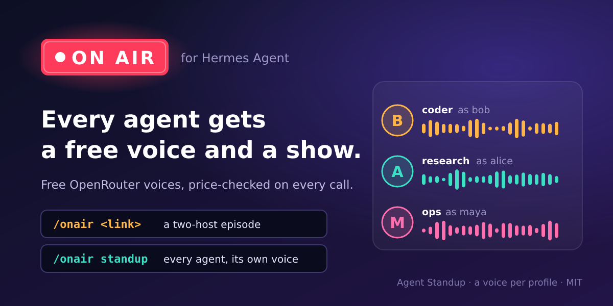

# On Air for Hermes



**Every Hermes agent gets a free voice and a show.**

- **Free voices:** set `tts.provider: onair` and Hermes speaks through
  OpenRouter's free Fish and HeyGen models (price-checked before every call).
- **A voice per profile:** each profile claims its own persona, so your agents
  never sound alike.
- **Two shows:** `/onair <link>` turns a page into a two-host episode, and
  `/onair standup` has each of your agents report its day in its own voice.

> v0.1.0, Linux and macOS. On Air is a native Hermes plugin. Its host side is
> standard-library Python, and the audio engine
> ([DropCast](https://github.com/luongnv89/dropcast)) runs in its own sidecar
> virtualenv.

- [Quick start](#quick-start)
- [Commands and tools](#commands-and-tools)
- [Settings](#settings)
- [Free means](#free-means)
- [Privacy and disclosure](#privacy-and-disclosure)
- [Troubleshooting](#troubleshooting)
- [How it works](#how-it-works)
- [Develop](#develop)

## Quick start

**You need:** Hermes Agent set up with a model (`hermes setup`; On Air's
scripts are written by that model),
[uv](https://docs.astral.sh/uv/getting-started/installation/) on `PATH`, and
`ssh -T git@github.com` working on this machine. Setup installs DropCast over
`git+ssh`, and the GitHub account must be able to read
`luongnv89/hermes-onair` and `luongnv89/dropcast`. `ffmpeg` is optional: it
enables HeyGen voices and non-MP3 output. Hermes's managed ffmpeg in
`~/.hermes/tools` is found on its own.

```sh
# 1. Install and enable the plugin. Once the repo is public,
#    `hermes plugins install luongnv89/hermes-onair --enable` works too.
hermes plugins install git@github.com:luongnv89/hermes-onair.git --enable

# 2. Create the sidecar and install the pinned DropCast (about a minute).
hermes onair setup
hermes onair setup --check        # "Result: OK" when ready

# 3. Speak with On Air's free voices.
hermes config set tts.provider onair

# 4. Optional: the free OpenRouter voices. Without a key, On Air uses edge-tts.
#    Export it, or add it to $HERMES_HOME/.env, which Hermes loads into its environment.
export OPENROUTER_API_KEY=sk-or-...

# 5. If a gateway is running (Telegram, Discord, …), restart it, so that it
#    loads the plugin and sees the key.
hermes gateway restart
```

Then, in any Hermes chat (CLI, TUI, Telegram, Discord, …):

```text
/onair voice
/onair https://science.nasa.gov/moon/facts/
```

The episode arrives about a minute later as an audio attachment, with its
transcript. From a shell, `hermes chat -q "/onair voice"` runs one command
and exits. On the CLI, the reply's last line is the MP3's path.

- **Check the install** with `hermes plugins list` (onair shows as
  `enabled`), `hermes plugins doctor onair` and `hermes onair setup --check`.
- **`hermes onair setup` is safe to run again.** A sidecar already at the pin
  is left alone. The sidecar lives in `$HERMES_HOME/plugin-data/onair/sidecar`.
- **Update** with `hermes plugins update onair`, then `hermes onair setup`.

## Commands and tools

| Command or tool | What it does | Example |
|-----------------|--------------|---------|
| `/onair <link or text>` | Records a two-host episode (MP3 and WebVTT transcript) from a web page or pasted text. Options: `--lang en\|fr\|vi`, `--minutes 1-5`. | `/onair --minutes 2 https://en.wikipedia.org/wiki/Tide` |
| `/onair voice` | Shows this profile's persona and its voice on each engine. It claims a persona on first use. | `/onair voice` |
| `/onair voice list` | Lists the 10 personas and which profile holds each. | `/onair voice list` |
| `/onair voice set <name> [--force]` | Changes this profile's persona. `--force` shares one that another profile holds. | `/onair voice set maya` |
| `/onair standup [profiles…]` | Records the Agent Standup: each opted-in profile reports its last 24 hours in its own voice. Each name must be a listed profile or an existing profile folder. Any other words make it an episode about that text. | `/onair standup default coder research` |
| `onair_episode` (agent tool) | The same pipeline as `/onair`, for the agent. Parameters: `source`, `language`, `minutes`. Returns JSON with a `MEDIA:` line. | "Make me a 2-minute episode about this article: …" |
| `onair_standup` (agent tool) | The same show as `/onair standup`. Parameters: `profiles`, `scheduled`. | "Run the On Air standup." |
| `tts.provider: onair` | Hermes's own `text_to_speech` speaks through On Air, in the profile's persona. | `hermes config set tts.provider onair` |
| `onair:standup` (Automation Blueprint) | A weekday morning standup, at a time and in a chat you choose (on Hermes builds with blueprints). | `/blueprint` |
| `hermes onair setup [--check]` | Installs or checks the DropCast sidecar. | `hermes onair setup --check` |

A command's reply comes in two parts. It says "🎙️ On Air is recording…" at
once. About a minute later it sends the episode: the hosts, the voices, who
wrote the script, the timings, the transcript path, and a last line
`MEDIA:/abs/path/episode.mp3`, which the gateway sends as an audio file.

## Settings

Put these under `plugins.entries.onair.settings` in `config.yaml`. Every key
is optional.

```yaml
# ~/.hermes/config.yaml
tts:
  provider: onair
plugins:
  entries:
    onair:
      settings:
        standup_profiles: [default, coder, research]   # opt-in for the standup
        episode_minutes: 1.5
        voices:
          edge: {fr: fr-FR-HenriNeural}
          heygen: {"*": tabitha}
```

| Key | Default | Meaning |
|-----|---------|---------|
| `standup_profiles` | `[]` | The profiles the Agent Standup may read. `default` is the root profile. A profile that is not listed is never read. |
| `episode_minutes` | `1.0` | Episode length (1 to 5 minutes) when `/onair` names none. |
| `keep_episodes` | `30` | How many episode and standup folders to keep. Older ones are removed after each new one. `0` keeps them all. |
| `language` | `auto` | Language of the text (`en`, `fr`, `vi`, …). `auto` detects en, fr or vi. |
| `voices` | `{}` | Voice overrides per engine and language, as in the example above (`"*"` means any other language). They apply to `text_to_speech` only. Episode hosts and standup speakers keep their personas' voices. |
| `ffmpeg_bin` | `""` | The ffmpeg path or name. When empty, On Air looks on `PATH`, then in `$HERMES_HOME/tools` and `~/.hermes/tools`. |
| `uv_bin` | `""` | The uv path or name. When empty, On Air looks on `PATH`. |
| `sidecar_python` | `">=3.11"` | The Python request for the sidecar's `uv venv --python`. |

Two Hermes settings matter too:

- `tts.voice: <engine>:<voice>` (for example `edge:en-GB-RyanNeural`) pins
  one engine's voice for `text_to_speech`.
- `tts.output_format` picks the speech format. It is `mp3` by default.
  `wav`, `ogg`, `opus` and `flac` need ffmpeg.

`text_to_speech` picks each voice in this order, and the first match wins:
`tts.voice`, then `voices`, then the profile's persona, then the built-in
default.

The script model is set by the `auxiliary.onair_script` setting. See
[Your model writes the script](#your-model-writes-the-script).

## Free means

On Air never calls a paid model, service or engine of its own. The scripts
run on your own configured model, so that cost follows your choice (see the
last point below).

**The engines, in fallback order.** One engine speaks each request: the
first one in the chain that works. Engines are never mixed within one
episode.

| Language | Chain |
|----------|-------|
| English | Fish → HeyGen → edge-tts |
| Any other | HeyGen → Fish → edge-tts |

- **Fish S2.1 Pro** (`fish-audio/s2.1-pro-free:free`) and **HeyGen voice 1
  turbo** (`heygen/heygen-voice-1-turbo:free`) are OpenRouter's free speech
  models. **They are promotions that may end.** When one ends or starts to
  cost money, On Air stops calling it and falls through to the next engine.
- **The price gate.** Before every OpenRouter call, On Air reads OpenRouter's
  public model list, which needs no key and is cached for up to 24 hours. It
  calls a model only when the model is listed, no listed price is non-zero,
  and its id ends in `:free` or every price is zero. With no list and no
  fresh cache, OpenRouter is skipped.
- **The key** comes only from the `OPENROUTER_API_KEY` environment variable.
  On Air never stores, logs or prints it. Without it, On Air goes straight to
  edge-tts.
- **Fall-through.** An engine is skipped on a missing key, a failed price
  check, any HTTP error (401, 402, 429, 5xx, …), a timeout, an empty or bad
  audio body, or, for HeyGen, no ffmpeg. An episode's reply names every
  engine it skipped, and why.
- **edge-tts** is the last resort, and it needs no key. It is an
  **unofficial** client for Microsoft Edge's read-aloud voices. **Its output
  is for private use only.** Delivering it to the requesting user's own chat
  or session is fine. Never publish it: no public post, plugin catalog entry,
  demo, or release asset. On Air says so in every `/onair` episode and
  standup reply voiced by edge-tts. Plain `text_to_speech` carries no such
  notice, so treat that speech as private too. A scheduled standup, which
  has no requesting user, never uses edge-tts.
- **Your own model** writes the scripts through Hermes (`ctx.llm`), so that
  cost follows your model choice. See below.

## Privacy and disclosure

**What On Air sends where.**

| To | What | When |
|----|------|------|
| OpenRouter (`openrouter.ai`) | The public model list (no key), then the text to speak, with your key | Only with `OPENROUTER_API_KEY` set |
| Microsoft's edge-tts service | The text to speak | When edge-tts renders |
| Your configured model, through Hermes `ctx.llm` | The source text, or the standup's session titles | Every episode and standup |
| The web page you name | A fetch of that page, made by DropCast | `/onair <link>` |
| GitHub, over SSH | The DropCast install | `hermes onair setup` |
| PyPI, and uv's Python downloads | DropCast's dependencies, and a Python if none fits | `hermes onair setup` |

Apart from the speech file Hermes asks `text_to_speech` to write, On Air
writes only under `$HERMES_HOME/plugin-data/onair/`: the sidecar, episodes,
standups, the profile's persona claim and the model-list cache. During
setup, uv also uses its own cache (for example `~/.cache/uv`) and Python
store. It runs no
background service and sends no telemetry.

**What any profile reads.** To keep voices distinct, claiming a persona and
`/onair voice list` read the other profiles' claim files
(`plugin-data/onair/persona.json` in each profile of the same Hermes root).
They only read those files, and they never write another profile's. Nothing
else outside the profile's own data is read, except by the standup.

**What the Agent Standup reads.**

- **Opt-in only.** It reads only profiles listed in `standup_profiles`. A
  profile named on the command line but not listed is refused before
  anything is opened, and so is every profile while the list is empty.
- **Read-only.** It reads each profile's own `state.db`: `<root>/state.db`
  for `default` and `<root>/profiles/<name>/state.db` otherwise, where
  `<root>` is the Hermes root (`~/.hermes` by default). The database is
  opened with SQLite's `mode=ro` and `PRAGMA query_only`, and it is never
  written or write-locked. Symbolic links are never followed.
- **Titles only.** It reads the titles, and summaries where they exist, of
  sessions active in the last 24 hours. It never reads a message, a prompt
  or a tool output.
- **Scrubbed.** Anything that looks like a secret is replaced by "redacted"
  before the titles reach your model, the voices or any file, and again
  after the model writes. That covers API keys and tokens, passwords given
  as `key: value` or in prose, private keys, URLs with a password, and long
  hex or base64 runs. File paths, links and email addresses are dropped. A
  title that held a secret is never sent to the model, and "redacted" is
  never spoken.
- The titles reach your model as fenced data that it is told never to
  follow.
- **Voices.** Each profile reads its own persona claim (read-only) so that it
  speaks in its own voice.

### Your model writes the script

Episode and standup scripts are written by **your own configured model**
through Hermes's `ctx.llm`. On Air passes no provider or model override, and
it records the model id that the call returns. The call runs through On
Air's auxiliary task `onair_script` ("On Air episode script"), whose only
default is `reasoning_effort: none`, so a reasoning model does not spend the
answer's token budget on thinking. To change it, add this to `config.yaml`
(your values override the plugin's defaults):

```yaml
auxiliary:
  onair_script:
    reasoning_effort: low   # none (the default), low, medium or high
```

When the model fails (free models often answer HTTP 429), a built-in
template made from the source's own sentences is used instead, and the
reply says so.

## Troubleshooting

| You see | Do this |
|---------|---------|
| `Hermes isn't configured yet -- no API keys or providers found` | Hermes has no model yet. Run `hermes setup`. |
| `/onair` is an unknown command | Run `hermes plugins list`. If onair shows as disabled, run `hermes plugins enable onair`. Then restart the gateway or start a new chat. |
| `the sidecar is not set up: run hermes onair setup first` | Run `hermes onair setup`, then `hermes onair setup --check`. |
| `✗ uv not found` | Install uv, or set `plugins.entries.onair.settings.uv_bin` to its path. |
| `✗ DropCast repository unavailable` | `ssh -T git@github.com` must work, and your GitHub account must be able to read `luongnv89/dropcast`. |
| `✗ Not touching …/sidecar` | Setup never deletes anything. Move the folder aside (`mv …/sidecar …/sidecar.old`), then run `hermes onair setup` again. This happens after an interrupted install or a pin change. |
| The reply says "Private listening only (edge-tts voices)" | No usable OpenRouter voice: either `OPENROUTER_API_KEY` is not set in Hermes's environment, or the free models were skipped. The `Skipped:` part of the reply gives the reason. |
| HeyGen is always skipped | HeyGen returns raw PCM and needs ffmpeg. Install it, or set `ffmpeg_bin`. |
| `Script: built-in template, because the LLM script failed (… 429 …)` | Your model was rate-limited. The episode still plays. Try again later, or use a model that isn't rate-limited. |
| `Script: … returned an empty answer` | A reasoning model used its budget on thinking. Keep `auxiliary.onair_script.reasoning_effort: none`. |
| `On Air standup: not opted in: …` or `no profile is opted in` | Add the profiles to `standup_profiles`. Only listed profiles are read. |
| A scheduled standup sends no audio | Scheduled runs never use edge-tts. Set `OPENROUTER_API_KEY` in the gateway's environment. |

## How it works

### Episodes

1. **Ingest.** DropCast reads the link (http or https only) or the text, and
   writes a brief: the length (`--minutes`, then `episode_minutes`), the
   language (`--lang`, then `language`, then detected), and no guests.
2. **Script.** Your model writes a two-host script in DropCast's
   `podcast-2host` format (see
   [Your model writes the script](#your-model-writes-the-script)). It retries
   once with backoff, and it is capped at about 150 spoken words per minute.
   Lines must quote the source, and a line with a link, email or phone
   number is dropped. The source is fenced as data that the model is told
   never to follow.
3. **Checks.** DropCast checks the show order, the fixed lines, the
   fact-check quotes and the length. A script that fails them is replaced by
   the template.
4. **Render.** One engine renders the whole episode (see
   [Free means](#free-means)). Your profile's persona hosts. The co-host
   is the next persona of the other voice type. When the host has a Fish
   voice, a co-host with one is preferred. The show keeps DropCast's fixed
   name, opening and sign-off ("Build Wiz AI Show"), because DropCast's
   checks accept no other.
5. **Deliver.** It writes `episode.mp3`, `transcript.vtt` and `onair.json`
   (engine, voices, script source, model id, timings) under
   `$HERMES_HOME/plugin-data/onair/episodes/<stamp>/`.

The "recording…" note goes through `ctx.post_message` where a session is
bound, and it is later edited to "recorded in N s". On the classic CLI it is
printed instead. The episode is the command's return value, because only a
command's reply carries `MEDIA:` attachments. The handler is synchronous, so
the gateway runs it on its worker pool.

### Voice personas

A profile claims a persona the first time it speaks (or runs `/onair voice`).
The claim starts at `sha256(profile) % 10`, skips personas held by other
profiles of the same Hermes root, and prefers a persona with a Fish voice. As
a result, up to 10 profiles never share a voice, and the first 7 all get a
Fish voice. The claim is stored in the profile's
`plugin-data/onair/persona.json`. An 11th profile shares the least-used
persona.

| Persona | Fish | HeyGen | edge en | edge fr | edge vi |
|---------|------|--------|---------|---------|---------|
| bob (man) | Ethan | lucian | en-US-AndrewNeural | fr-FR-HenriNeural | vi-VN-NamMinhNeural |
| alice (woman) | Hannah | tabitha | en-US-AvaNeural | fr-FR-DeniseNeural | vi-VN-HoaiMyNeural |
| maya (woman) | Laura | meredith | en-GB-SoniaNeural | fr-CH-ArianeNeural | pt-BR-ThalitaMultilingualNeural |
| sam (man) | Adrian | gareth | en-US-GuyNeural | fr-BE-GerardNeural | en-US-BrianMultilingualNeural |
| lena (woman) | Sarah | noelle | en-US-EmmaNeural | fr-CA-SylvieNeural | de-DE-SeraphinaMultilingualNeural |
| theo (man) | Jordan | vincent | en-GB-RyanNeural | fr-CA-ThierryNeural | en-AU-WilliamMultilingualNeural |
| nadine (woman) | Selene | nadine | en-US-AriaNeural | fr-FR-VivienneMultilingualNeural | fr-FR-VivienneMultilingualNeural |
| bram (man) | — | bram | en-US-ChristopherNeural | fr-FR-RemyMultilingualNeural | fr-FR-RemyMultilingualNeural |
| sabrina (woman) | — | sabrina | en-US-JennyNeural | fr-FR-EloiseNeural | en-US-AvaMultilingualNeural |
| weston (man) | — | weston | en-US-EricNeural | fr-CA-AntoineNeural | de-DE-FlorianMultilingualNeural |

- **Fish** has 7 official free voices, which DropCast records with their
  terms (personal, non-commercial use). bram, sabrina and weston have none,
  so Fish is skipped for them. A `voices` setting or `tts.voice: fish:<id>`
  brings Fish back.
- **HeyGen** has 10 voices on its free model, one per persona.
- **edge-tts** has only 2 native Vietnamese voices. The other personas speak
  Vietnamese with Microsoft's multilingual voices.
- Every voice is a stock voice of a free engine. Nothing is cloned.
- Claims are found by reading the other profiles' claim files. No other
  profile's file is ever written. Two claims made at the same moment are
  serialized by an `flock` on the root directory.

### The Agent Standup

The show opens with "This is the On Air standup for <weekday, day month>:
three agents report." (the count is spoken as a word) and closes with
"That's the standup. Back tomorrow."
Between those lines, each listed profile speaks a segment of 2 to 4
sentences, at most 40 words, in its own persona's voice. One `ctx.llm` call
(the `onair_script` task) writes every segment. When that call fails, a
template reads out the titles. DropCast's finish step joins the segments with
the show's theme and evens out the loudness, so 3 agents take about a minute.

Some profiles get a short segment instead:

- A profile with no sessions that day gets a one-line "quiet day" segment.
- A profile whose `state.db` cannot be read gets a "could not be read"
  segment.

Each profile speaks with its own claimed persona. A profile without one gets
a fixed persona for that show only, and nothing is written. The standup
ignores the `voices` setting, so every speaker stays distinct.

The `onair:standup` blueprint runs `onair_standup` with `scheduled: true` on
weekday mornings. A scheduled run has no requesting user, so it uses only
OpenRouter's free voices. Without a key, it says why and sends no audio.

## Develop

```sh
python -m venv .venv && . .venv/bin/activate
pip install -r requirements-dev.txt
ruff check .
pytest -q            # offline: network, DNS and new processes are blocked
pytest -m live       # by hand only: tests that reach real services
```

- Read `AGENTS.md` first. Its five hard rules override everything else: free
  engines only, the key only from the environment, edge-tts output for
  private use, DropCast only through `adapter.py`, and an offline default
  test run.
- The live smoke test speaks one sentence through Fish and HeyGen, after the
  price gate:
  `OPENROUTER_API_KEY=... pytest -m live tests/test_live.py -v -s`. Add
  `-k persona` to try every persona's voices (7 + 10 free requests).
- Try the plugin in an isolated `HERMES_HOME` outside `~/.hermes`, for
  example `HERMES_HOME=/tmp/onair-home`, and follow the
  [Quick start](#quick-start). A new home has no model yet: run
  `hermes setup` there, or point `model.*` at a local endpoint. The
  [Quick start](#quick-start)'s first command prepares the home's runtime. If
  another command in a new home asks for `hermes pm repair`, run that once.
  Homes inside `~/.hermes` share the real install.
- Before a PR, run `hermes plugins validate .` and
  `hermes plugins doctor . --ci` in that isolated home.
- CI runs ruff and the offline tests on Python 3.11 and 3.13.

## License

MIT. DropCast and the voice engines have their own terms. Fish's official
voices are for personal, non-commercial use, and edge-tts output is for
private use only.
